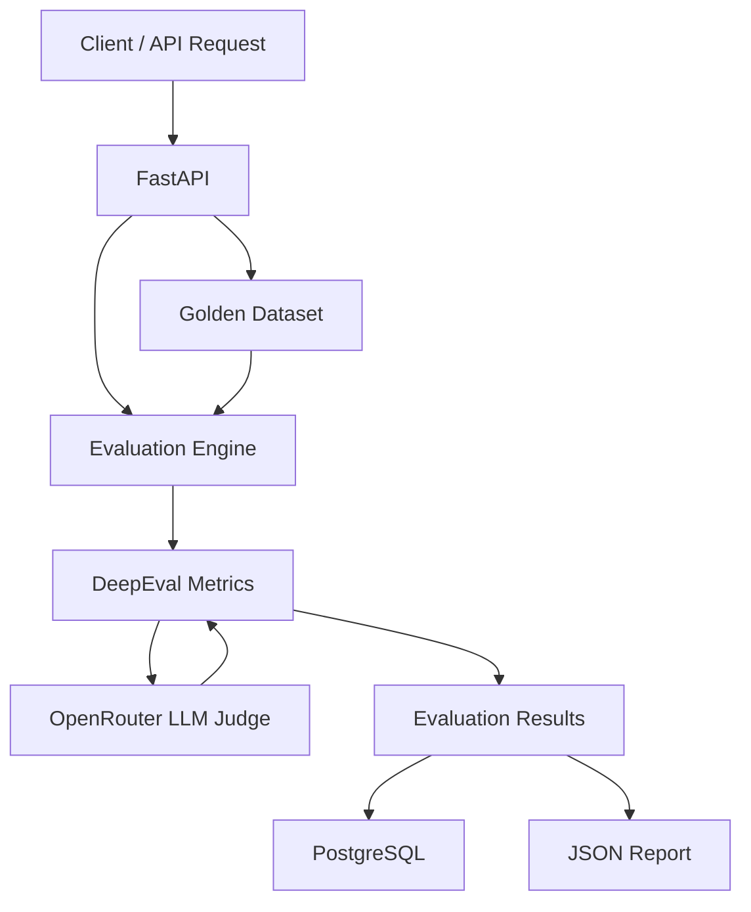

# EvalForge — LLM Evaluation Framework

**Evaluate the quality and reliability of LLM-generated responses.**

EvalForge is a Python-based LLM evaluation framework that helps assess AI-generated responses against a curated golden dataset. It uses DeepEval metrics and an LLM judge powered by OpenRouter to evaluate response quality through measurable criteria.

## Overview

As LLM-powered applications become increasingly common, evaluating their outputs for correctness, relevance, and hallucinations becomes essential.

EvalForge provides a structured way to evaluate AI responses using predefined test cases, configurable metric thresholds, and persistent evaluation records.

## Key Features

- **LLM Evaluation:** Evaluate responses using Faithfulness, Answer Relevancy, and Hallucination metrics.
- **Golden Dataset:** Create, retrieve, update, and delete evaluation test cases.
- **Configurable Metrics:** Enable or disable metrics and configure their evaluation thresholds.
- **LLM Judge Integration:** Uses OpenRouter to provide the model backend for LLM-based evaluation.
- **Evaluation History:** Persist evaluation summaries and retrieve previous evaluation runs.
- **JSON Reports:** Generate structured reports containing evaluation results.
- **REST API:** Expose evaluation and dataset management functionality through FastAPI endpoints.
- **Automated Testing:** Validate application behavior using Pytest.
- **Containerization & CI:** Docker support and automated test execution through GitHub Actions.

## Architecture



## Evaluation Metrics

| Metric | What it evaluates |
|---|---|
| Faithfulness | Whether the response is supported by the provided context |
| Answer Relevancy | Whether the response addresses the user's input |
| Hallucination | Whether the response contains unsupported or fabricated information |

Each metric can be configured with an individual threshold. Evaluation results help identify responses that do not meet the configured quality criteria.

## How It Works

1. Add test cases to the golden dataset, including the input, actual output, expected output, and context.
2. Trigger an evaluation through the REST API.
3. EvalForge constructs evaluation test cases and runs the enabled DeepEval metrics.
4. OpenRouter provides the LLM judge used by the evaluation process.
5. Results are stored in PostgreSQL and a JSON report is generated.
6. Retrieve evaluation history and reports through the API.

## Tech Stack

| Category | Technologies |
|---|---|
| Language | Python |
| API Framework | FastAPI |
| Evaluation | DeepEval |
| LLM Provider | OpenRouter |
| Database | PostgreSQL, Neon |
| ORM | SQLAlchemy |
| Migrations | Alembic |
| Testing | Pytest |
| Containerization | Docker, Docker Compose |
| CI/CD | GitHub Actions |

## API Endpoints

| Method | Endpoint | Description |
|---|---|---|
| GET | `/` | API information |
| GET | `/health` | Health check |
| GET | `/dataset` | Retrieve golden dataset |
| POST | `/dataset` | Add a test case |
| GET | `/dataset/{id}` | Retrieve a test case |
| PUT | `/dataset/{id}` | Update a test case |
| DELETE | `/dataset/{id}` | Delete a test case |
| POST | `/evaluations` | Start an evaluation |
| GET | `/evaluations` | Retrieve evaluation history |
| GET | `/evaluations/{id}` | Retrieve evaluation details |
| GET | `/reports` | List generated reports |
| GET | `/reports/{filename}` | Retrieve a report |

Interactive API documentation is available through Swagger UI at `/docs`.

## Screenshots

_Add screenshots after deployment._

| API Documentation | Evaluation Results |
|---|---|
|  |  |

| Golden Dataset | Generated Report |
|---|---|
|  |  |

## Getting Started

### Prerequisites

- Python 3.10+
- Docker and Docker Compose (optional)
- PostgreSQL database
- OpenRouter API key

### 1. Clone the repository

```bash
git clone YOUR_GITHUB_REPOSITORY_URL
cd evalforge
```

### 2. Create and activate a virtual environment

```bash
python -m venv .venv
```

macOS / Linux:

```bash
source .venv/bin/activate
```

Windows:

```bash
.venv\Scripts\activate
```

### 3. Install dependencies

```bash
pip install -r requirements.txt
```

### 4. Configure environment variables

Create a `.env` file in the project root:

```env
OPENROUTER_API_KEY=your_openrouter_api_key
OPENROUTER_MODEL_NAME=openrouter/free
OPENROUTER_BASE_URL=https://openrouter.ai/api/v1

DATABASE_URL=your_postgresql_connection_string
```

If API authentication is enabled in your deployment, configure the application's access key as well.

**Security:** Never commit `.env` or expose your OpenRouter API key in client-side code.

### 5. Run database migrations

```bash
alembic upgrade head
```

### 6. Start the application

```bash
uvicorn app.api:app --reload
```

The API will be available at:

- API: `http://localhost:8000`
- Swagger documentation: `http://localhost:8000/docs`
- Health check: `http://localhost:8000/health`

## Run with Docker

Build and start the application:

```bash
docker compose up --build
```

Stop the application:

```bash
docker compose down
```

## Running Tests

Run the complete test suite:

```bash
pytest -v
```

The project also uses GitHub Actions to run automated tests on pushes and pull requests.

## Deployment

The application is designed to be deployed as a Docker-based web service.

**Deployment:** [EvalForge Live API — Add Render URL]

**API Documentation:** [Swagger UI — Add Render URL/docs]

**Health Check:** [Health Endpoint — Add Render URL/health]

Configure the required environment variables in the hosting platform. Keep API credentials server-side.

## Project Structure

```text
evalforge/
├── app/
│   ├── api.py
│   ├── evaluator.py
│   ├── reporter.py
│   ├── schemas.py
│   ├── database.py
│   ├── models.py
│   ├── dataset_repository.py
│   └── evaluation_repository.py
├── datasets/
│   └── golden_dataset.json
├── tests/
├── migrations/
├── reports/
├── .github/
│   └── workflows/
│       └── ci.yml
├── Dockerfile
├── docker-compose.yml
├── alembic.ini
├── requirements.txt
└── pytest.ini
```

## Future Improvements

- Expand evaluation coverage with safety, prompt injection, and multi-turn test cases.
- Add evaluation support for tool-calling workflows.
- Introduce latency and token-cost tracking.
- Add a dashboard for comparing evaluation runs and metric trends.
- Integrate additional evaluation frameworks and model providers.

---

**EvalForge** — Making LLM quality measurable.